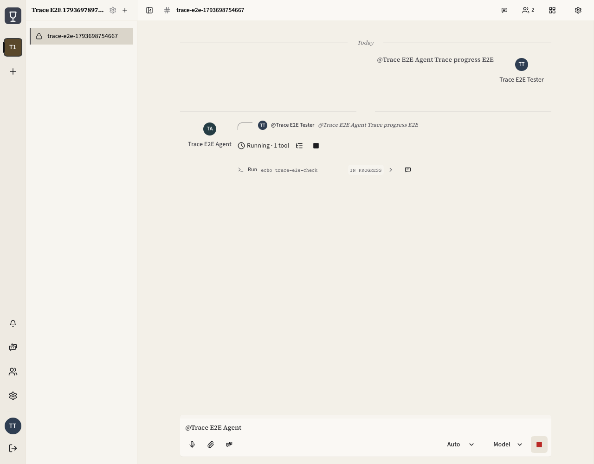
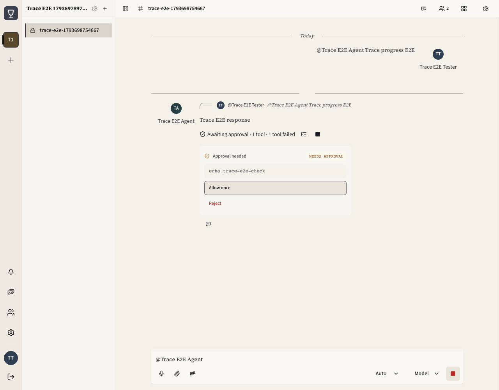
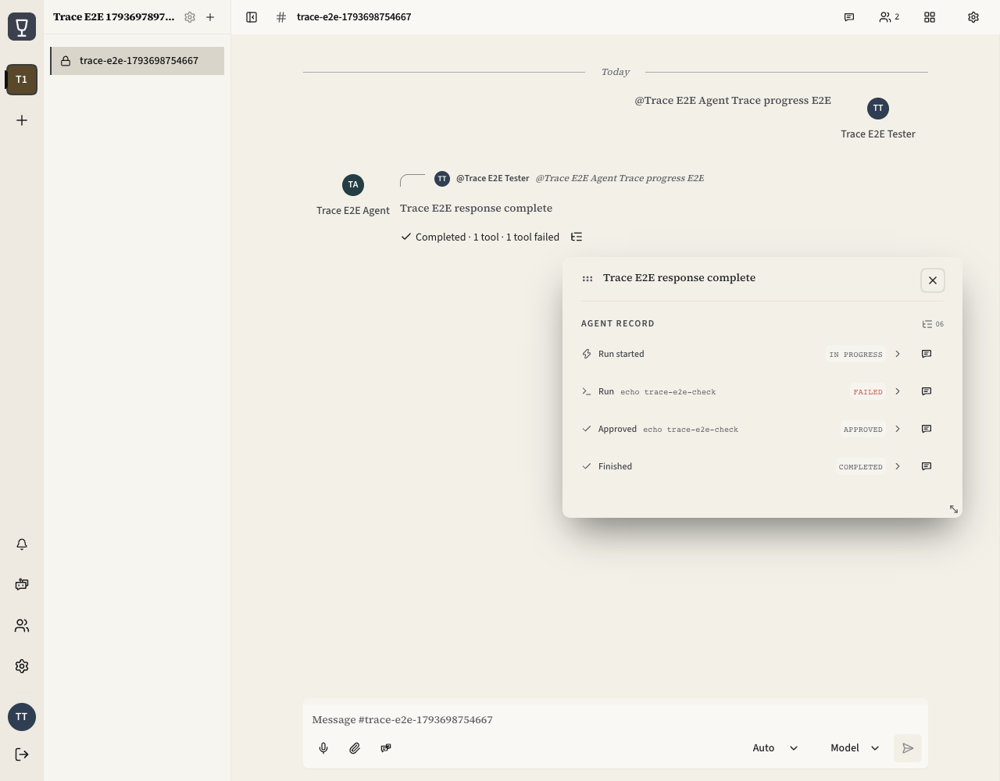

# Chat progress deduplication — verification evidence

Date: 2026-11-03. Frontend base: `84ec98bc` (`origin/develop`).

## Problem and resulting behavior

The realtime message hook derived a legacy `_trace` string from the same event
already rendered by the structured trace panel. The message body also showed a
progress cursor and a separate Stop action while the run overview showed the
turn status. Lifecycle rows and status-only previews repeated that state again.
Expanded approvals could repeat the command and approval status in two headers.

The run overview now owns turn status and its adjacent message-level Stop action.
The body renders response content, with thinking feedback retained before the
first trace arrives. Pending approvals expose their command and choices once;
otherwise the inline panel shows the latest event. Full history remains in the
message record. Summary text wraps so failures remain readable on narrow screens.
The client-only `_trace` producer and field were removed; no compatibility shim
or server/API migration is required.

## Results

| Check | Result | Evidence |
| --- | --- | --- |
| Focused frontend tests | 6 files, 54 tests passed | [Validation output](validation-output.txt) |
| TypeScript | `pnpm typecheck` passed | [Validation output](validation-output.txt) |
| ESLint | All changed TypeScript/TSX files passed | [Validation output](validation-output.txt) |
| Design-system scanner | Passed | [Validation output](validation-output.txt) |
| Production frontend build | Passed, including service worker | [Build output](build-output.txt) |
| Real-stack browser verification | 7 scenarios passed | [E2E report](e2e-report.json) |

The build reports the existing large-chunk advisory. The focused checks are not
a claim that the full frontend unit suite or repository-wide E2E suite ran.

## Real-stack browser coverage

The local source frontend ran in Vite and connected through the development
kind/Helm cluster's Nginx entry point to its real Rust gateway and PostgreSQL.
The deployed gateway image was `cheers/gateway:dev`. System Google Chrome ran
headless through Playwright. HTTP and browser WebSocket traffic were not mocked.

The Agent Bridge peer was a deterministic protocol fixture, authenticated with
its own temporary host credential. It emitted trace and permission events;
the displayed `echo trace-e2e-check` command was not executed, and no external
model provider was called.

1. Log in in the browser using a temporary user's password and TOTP.
2. Pick the test bot through the real mention picker, submit a message, accept
   the gateway task, and receive live trace frames through the channel socket.
   Assert one inline trace, one run summary, and one message-level Stop action.
   The composer's existing conversation-wide Stop is a separate control.
3. Report a tool failure while the run remains active; verify the failed-tool
   count and streamed response without another progress cursor.
4. Forward a real permission request; assert one command, one approval badge,
   and immediately available choices, then resolve it through the browser card.
5. Publish the completed result and require a successful terminal ACK. Reload
   the page; restore the completed summary and durable trace history from the
   gateway. Open the record with Enter, close with Escape, and restore focus.
6. Click the message-level Stop; verify the actual cancel HTTP response and
   matching cancel frame on the connector control socket, then the cancelled
   lifecycle display. This check covers cancellation delivery and UI state;
   it does not assert acceptance of a late terminal result after cancellation.
7. Inspect the completed real conversation at 390, 768, and 1280px in light
   and dark appearances with reduced motion. Assert no page overflow or clipped
   summary text. On mobile, open the channel from the list when necessary to
   enter the application's pushed conversation screen.

The final run recorded no page JavaScript errors and no bridge error frames.
All temporary test channels, workspaces, bot/host, and user were removed through
the application's APIs afterward. Local credential and browser-session artifacts
were scrubbed and are excluded from this evidence bundle.

An initial `kubectl port-forward` connection dropped during earlier attempts.
The successful run used the cluster's existing Nginx/NodePort entry point.
Only the final successful run's screenshots and report are included here.

## Screenshots

### Live progress



### Approval



### Durable record after reload



### Responsive appearances

| Width | Light | Dark |
| --- | --- | --- |
| 390px | [Light mobile](screenshots/05-light-390.png) | [Dark mobile](screenshots/05-dark-390.png) |
| 768px | [Light tablet](screenshots/05-light-768.png) | [Dark tablet](screenshots/05-dark-768.png) |
| 1280px | [Light desktop](screenshots/05-light-1280.png) | [Dark desktop](screenshots/05-dark-1280.png) |

## Assertion driver and rerun prerequisites

[browser-driver.mjs](browser-driver.mjs) archives the successful run's assertions.
After that run, its machine-specific import, private fixture directory, and
service origins were parameterized. The parameterized copy was syntax-checked;
the recorded real-stack result belongs to the captured run described above.

Install frontend dependencies with pnpm and provide system Chrome. Supply these
environment variables; the two service origins must be HTTP loopback origins
with explicit ports, following the repository's integration-test URL contract:

```sh
INTEGRATION_BASE_URL=http://127.0.0.1:<vite-port> \
E2E_GATEWAY_URL=http://127.0.0.1:<gateway-or-nginx-port> \
CHEERS_TRACE_E2E_DIR=<private-scratch-directory> \
node docs/testing/chat-progress-deduplication-2026-11-03/browser-driver.mjs
```

The private scratch directory must contain a `fixture.json` provisioned through
the normal development APIs. Its shape is:

```text
user:          { user_id, username, password }
totpSecret:    the temporary user's enrolled TOTP secret
userWorkspace:{ workspace_id }
bot:           { bot_id, username } with display_name "Trace E2E Agent"
host:          { credential } for that bot's active test host
channel:       { channel_id } for an owned, disposable test channel
```

The fixture user must own the workspace, bot, and channel. The bot must be a
member of the disposable channel, use a generic Agent Bridge binding, and have
`binding_config.acp_security.require_capability=false` for this unsigned test
peer. Configure only this temporary test bot; do not change existing hosts or
instance security settings. The driver deletes and recreates its supplied test
channel, emits only deterministic events, and writes credential-bearing fixture
and browser state back into the private scratch directory. Keep that directory
outside Git and clean up the temporary resources through their normal APIs.

[evidence-manifest.json](evidence-manifest.json) records SHA-256 hashes for the
changed application files and archived evidence.
